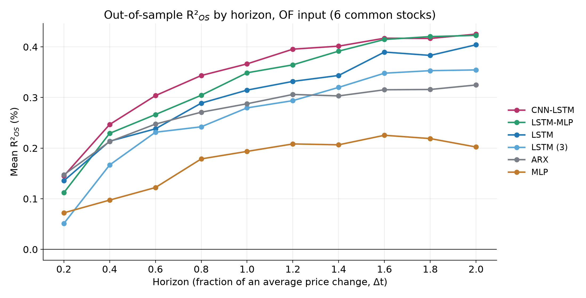

# Deep Order Flow Imbalance on IEX DEEP

**Contributors:** [Artemiy Maselskas](https://github.com/artemii2006) · [Maria Sudarikova](https://github.com/Sudarikovamaria) · [Anastasiya Polishchuk](https://github.com/AnastasiyaPolishchuk)


A replication of Kolm, Turiel and Westray, *Deep Order Flow Imbalance: Extracting Alpha at Multiple Horizons from the Limit Order Book* (SSRN 3900141, 2021; Mathematical Finance 33(4), 2023), on IEX exchange data instead of Nasdaq/LOBSTER.

Neural networks and a linear model forecast mid-price returns at 10 horizons at once (from 0.2 to 2 "average price changes" Δt) from the last 100 order book events. We test the paper's four findings on a secondary venue with hidden liquidity and add three experiments beyond the paper.

Seminar presentation: [docs/presentation.pptx](docs/presentation.pptx).

## Results

Mean out-of-sample R²<sub>OS</sub>, OF (order flow) input, 6 stocks × 3 rolling windows, 15 test days per stock. As in Figure 2 of the paper, R²<sub>OS</sub> is first averaged over days for each stock, then over stocks.

| Model | Mean R²<sub>OS</sub> | Horizon 0.2Δt | 1Δt | 2Δt | Stocks with R²<sub>OS</sub> significantly > 0 (1%) |
|---|---|---|---|---|---|
| CNN-LSTM | **0.35%** | 0.15% | 0.37% | 0.43% | 5 of 6 |
| LSTM-MLP | 0.33% | 0.11% | 0.35% | 0.42% | 4 |
| LSTM | 0.30% | 0.14% | 0.32% | 0.40% | 3 |
| ARX (ridge) | 0.27% | 0.15% | 0.29% | 0.33% | 3 |
| LSTM (3) | 0.26% | 0.05% | 0.28% | 0.35% | 3 |
| MLP | 0.17% | 0.07% | 0.19% | 0.20% | 3 |
| *ARX + CNN-LSTM ensemble (extension)* | *0.39%* | *0.21%* | *0.41%* | *0.47%* | *5* |



### The paper's findings on IEX data

1. **OF beats raw order book states (LOB).** Tested for two models, as in Table 3 of the paper: ARX (trained like the paper, with Adam) −0.25% on OF vs −0.52% on LOB; MLP +0.17% vs −2.38%. In both cases OF is better for 5 of 6 stocks (the exception is the small-tick UBER), but with 15 test days only one difference is significant at 1% (MLP, BAC). LSTM-based models were not trained on LOB because of the compute budget (deviation 9).
2. **Models with an LSTM beat linear models.** Reproduced. The top three are the same as in Figure 3 of the paper: CNN-LSTM, LSTM-MLP and LSTM. By mean R²<sub>OS</sub> they come in the paper's order; by average rank the first two swap places (LSTM-MLP 2.63, CNN-LSTM 2.83; 2.9 and 2.6 in the paper). LSTM (3) is fourth, as in the paper. CNN-LSTM beats ARX for 5 of 6 stocks, significantly at 1% for BAC and NKE. The one discrepancy: our MLP ranks below ARX, while the paper's ranks above, because our ridge ARX is stronger than the paper's ARX (see the extensions).
3. **R²<sub>OS</sub> rises up to about 2Δt.** Reproduced for all models.
4. **Large-tick stocks are more predictable.** Reproduced: the rank correlation of the LSTM's R²<sub>OS</sub> with tick size is +0.94, and with log(updates / price changes) +0.89; all Table 5 regressions have the paper's signs (`results/report/table5_cross_section.csv`).

R²<sub>OS</sub> is lower than in the paper (~1–1.5% on Nasdaq): IEX sees only its own, small share of liquidity. For large-tick stocks the best models reach 0.6–0.8% (BAC, NKE).

### Appendix B: OFI instead of OF

- LSTM on OFI ≈ LSTM on OF (0.31% vs 0.30%), as in the paper.
- ARX trained like the paper (Adam): OFI is significantly better than OF for 4 of 6 stocks (−0.25% → +0.05%), which reproduces the paper's effect. With ridge regression there is no difference (0.27% and 0.28%): the penalty already suppresses the overfitting that fewer features fix in the paper.
- MLP on OFI is worse than on OF (0.09% vs 0.17%); the paper finds the opposite.

### Extensions (beyond the paper)

- **Ensemble**: a plain average of the ARX and CNN-LSTM forecasts, with no weight tuning. Better than both models at every horizon: 0.39% vs 0.35% and 0.27%.
- **One ARX for all 11 stocks** instead of one per stock (the universality question the paper leaves aside). No worse on average, but significantly worse for large-tick stocks (BAC, NKE, VZ), which carry a strong stock-specific signal.
- **ARX: ridge vs Adam.** Ridge is stronger on both OF (0.27% vs −0.25%) and OFI (0.28% vs 0.05%), so the neural networks' gain over our ARX is smaller than it would be over the paper's ARX.

## Data

- **IEX DEEP** (price-level order book, displayed orders only) from the free IEX HIST archive. Data provided for free by IEX. [IEX Historical Data Terms of Use](https://www.iex.io/products/market-data-connectivity/hist-terms).
- **Period**: 12 weeks, 20 July – 9 October 2026 (59 trading days), three rolling windows following the paper: one validation week, four training weeks, one test week, moved forward by three weeks.
- **Stocks** (`configs/tickers.yaml`): common stocks with Δt ≥ 180 ms and ≥ 300k book events per day, selected on the day before the period. ARX runs on 11 stocks, the neural networks on 6 (BAC, VZ, NKE, USB, OXY, UBER).
- **Dataset v1**: only clean books (`data/book/{TICKER}/{date}.parquet`) and day characteristics (`data/meta/…`), ~4 GB; inputs and targets are computed from them on the fly. Raw data and the dataset are not committed; [data/README.md](data/README.md) describes every format, with 200-row samples in `data/samples/`.

Every deviation from the paper, and every decision where the paper is silent, is listed in [DEVIATIONS.md](DEVIATIONS.md).

## How to run

```bash
python3 -m venv .venv && source .venv/bin/activate
python -m pip install -r requirements.txt
pytest -q
```

Train and evaluate one model on the three windows (dataset v1 unpacked to `~/data/deepofi_dataset_v1`):

```bash
python scripts/freeze_dataset.py --verify --root ~/data/deepofi_dataset_v1
python -m deepofi.cli train --model cnn_lstm --ticker BAC --input of --data-root ~/data/deepofi_dataset_v1
python scripts/make_report.py --data-root ~/data/deepofi_dataset_v1
```

Models: `arx`, `mlp`, `lstm`, `lstm3`, `lstm_mlp`, `cnn_lstm`; inputs: `of`, `lob`, `ofi`. LSTM, LSTM (3), LSTM-MLP and MLP use `--learning-rate 1e-4` (deviation 13), and LSTM (3) also `--epochs 12`. By default ARX is solved by closed-form ridge regression; `--sgd` trains it with Adam like the paper. Results go to `results/{model}/{input}/{ticker}/window_0N/` (`history.csv`, and `metrics.csv` with weekly and daily R²<sub>OS</sub>), weights to `weights/{model}/{input}/{ticker}/window_0N.pt` (committed for every run in `results/` except the ensemble and pooled ARX).

Building the dataset from scratch (several hundred GB of downloads, ~10 hours):

```bash
python scripts/overnight.py                      # download the selection day and the period, extract candidate stocks
python scripts/build_dataset.py data/records/2026*.bin --tickers DIS CTSH UBER MO NEE OXY USB BSX NKE VZ BAC
python scripts/freeze_dataset.py                 # MANIFEST.json with checksums
```

## Layout

```
src/deepofi/
  iex/            IEX DEEP parser (pcap/pcapng, IEX-TP) and HIST download
  data_process/   order book, cleaning, OF/LOB/OFI, targets, windows, normalization, stock selection
  models/         ARX, MLP, LSTM, LSTM (3), LSTM-MLP, CNN-LSTM
  evaluation/     R²OS (weekly and daily), model comparison
  cli.py          train / evaluate / predict over the three windows
scripts/          download, pilot, dataset build and freeze, report, extensions
configs/          pipeline parameters and the stock list
docs/             seminar presentation
results/          metrics of every run and the report figures (results/report)
tests/            pipeline and model tests
```
